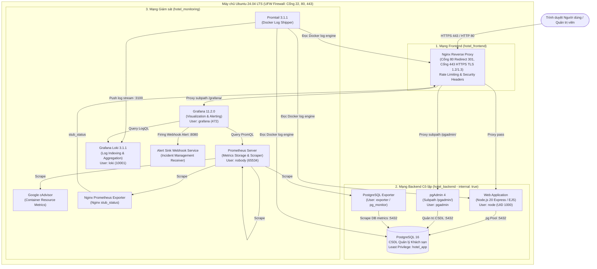

# HỆ THỐNG ĐẶT PHÒNG KHÁCH SẠN (HOTEL BOOKING SYSTEM)
### Đồ án Chuyên đề: Triển khai và Quản trị Hệ thống Phần mềm (DevOps & Hardening)

- **Sinh viên thực hiện**: Quách Anh Tuấn
- **Mã số sinh viên (MSSV)**: DTC245180025
- **Email**: narukun2812@gmail.com
- **GitHub Repository**: [DTC245180025-hotel-devops](https://github.com/tubanhoa/DTC245180025-hotel-devops)
- **Môi trường triển khai**: Ubuntu Server 24.04 LTS trên VMware Workstation / VirtualBox (IP: `192.168.186.130`)

---

## 1. Giới thiệu Dự án
Hệ thống quản lý và đặt phòng khách sạn là một giải pháp web phân tán hiện đại, đáp ứng đầy đủ nghiệp vụ lưu trú khách sạn theo tiêu chuẩn thực tế với 3 phân quyền người dùng độc lập:
1. **Khách hàng (Customer)**: Xem danh mục các hạng phòng nghỉ dưỡng, tra cứu tình trạng phòng trống theo ngày nhận - trả phòng, thực hiện đặt phòng trực tuyến chống xung đột lịch, quản lý lịch sử đặt phòng cá nhân.
2. **Lễ tân (Staff)**: Tiếp nhận đặt phòng trực tiếp tại quầy (Walk-in), làm thủ tục nhận phòng (Check-in), gọi thêm dịch vụ phát sinh (Ăn sáng buffet, Spa, Thuê xe, Đưa đón sân bay,...), làm thủ tục trả phòng (Check-out), tính toán hóa đơn và xác nhận thanh toán (tiền mặt/thẻ/chuyển khoản QR), quản lý trạng thái dọn dẹp buồng phòng.
3. **Quản trị viên (Manager)**: Theo dõi biểu đồ doanh thu và công suất phòng KPI, quản lý danh mục hạng phòng (kèm tính năng tải ảnh an toàn), quản lý số phòng, bảng giá dịch vụ và tài khoản nhân sự.

---

## 2. Sơ đồ Kiến trúc Hệ thống (System Architecture)

Hệ thống được thiết kế theo mô hình **Microservices trên Docker Containers** với kiến trúc phòng thủ theo chiều sâu (Defense-in-Depth), phân chia thành 3 phân vùng mạng cô lập:



---

## 3. Yêu cầu Hệ thống
- **Hệ điều hành**: Ubuntu Server 22.04 LTS hoặc 24.04 LTS (kiến trúc x86_64).
- **Tài nguyên tối thiểu**: 2 vCPU, 4 GB RAM (khuyến nghị 6 GB RAM), 25 GB ổ đĩa trống.
- **Phần mềm bắt buộc**:
  - Docker Engine >= 24.0 (hoặc Docker Engine 27.x)
  - Docker Compose v2 (plugin `docker compose`)
  - OpenSSL, cURL, Git, Python 3, jq

---

## 4. Hướng dẫn Khởi chạy Hệ thống "Bằng Một Lệnh"

### Bước 1: Clone mã nguồn từ GitHub
```bash
git clone https://github.com/tubanhoa/DTC245180025-hotel-devops.git ~/hotel
cd ~/hotel
```

### Bước 2: Thiết lập cấu hình biến môi trường
Sao chép tệp cấu hình mẫu và phân quyền an toàn:
```bash
cp .env.example .env
chmod 600 .env
```
*(Tùy chọn: Chỉnh sửa các giá trị mật khẩu trong `.env` nếu cần thiết)*.

### Bước 3: Sinh chứng chỉ SSL tự ký cho HTTPS
Hệ thống sử dụng Nginx Reverse Proxy bảo vệ toàn bộ lưu lượng qua giao thức HTTPS. Chạy script sinh chứng chỉ SSL tự ký có Subject Alternative Name (SAN) cho IP máy chủ:
```bash
chmod +x nginx/gen-cert.sh
./nginx/gen-cert.sh
```
Chứng chỉ `server.crt` và khóa bí mật `server.key` sẽ được lưu trữ an toàn trong thư mục `nginx/certs/` (đã được cấu hình tự động loại trừ khỏi Git).

### Bước 4: Khởi động toàn bộ 12 dịch vụ
Chạy lệnh khởi động duy nhất:
```bash
docker compose up -d --build
```

Kiểm tra trạng thái sẵn sàng của 12/12 container:
```bash
docker compose ps
```
*Tất cả 12 container sẽ chuyển sang trạng thái `Up` và các dịch vụ có healthcheck sẽ chuyển sang `(healthy)`*.

---

## 5. Bảng Địa chỉ Truy cập & Tài khoản Mẫu

| Dịch vụ | Giao thức / URL | Mô tả & Cổng nội bộ | Tài khoản mặc định | Mật khẩu |
|---|---|---|---|---|
| **Website Đặt phòng Khách sạn** | `https://<VM_IP>/` | Giao diện đặt phòng khách hàng & nghiệp vụ | Khách hàng: `khach01`<br>Lễ tân: `letan01`<br>Quản lý: `admin` | Xem tệp `.env` (`SEED_*_PASSWORD`) |
| **Quản trị CSDL pgAdmin 4** | `https://<VM_IP>/pgadmin/` | Quản trị cơ sở dữ liệu PostgreSQL trực quan | `admin@hotel.com` | Xem tệp `.env` (`PGADMIN_DEFAULT_PASSWORD`) |
| **Giám sát Hiệu năng Grafana** | `https://<VM_IP>/grafana/` | Bảng điều khiển metrics & logs tập trung | `admin` | Xem tệp `.env` (`GRAFANA_ADMIN_PASSWORD`) |
| **Cổng chuyển hướng HTTP** | `http://<VM_IP>/` | Cổng 80 tự động chuyển hướng 301 sang HTTPS | Không áp dụng | Tự động chuyển tiếp |

> [!IMPORTANT]
> **Chính sách Không lộ Mật khẩu**: Toàn bộ mật khẩu nhạy cảm của hệ thống được quản lý tập trung trong tệp `.env` và không bao giờ được ghi trực tiếp vào mã nguồn hay tài liệu công khai.

---

## 6. Hướng dẫn Sử dụng Hệ thống theo Vai trò

### 1. Vai trò Khách hàng (Customer - `khach01`)
1. Truy cập `https://<VM_IP>/login` và đăng nhập với tài khoản khách hàng.
2. Tại trang **Danh sách phòng (`/rooms`)**: Xem các hạng phòng (Standard, Superior, Deluxe, Family, Suite, Royal Penthouse).
3. Sử dụng bộ lọc ngày nhận phòng (`Check-in`) và ngày trả phòng (`Check-out`) để tìm kiếm phòng trống.
4. Bấm **Đặt phòng ngay**: Điền số lượng khách và ghi chú yêu cầu đặc biệt. Hệ thống tự động tính toán tổng tiền và tạo mã đặt phòng định dạng `BK-YYYYMM-XXX`.
5. Vào menu **Lịch sử đặt phòng (`/my-bookings`)** để theo dõi trạng thái đơn đặt hoặc thực hiện hủy đặt phòng khi chưa làm thủ tục nhận phòng.

### 2. Vai trò Lễ tân (Staff - `letan01`)
1. Đăng nhập bằng tài khoản lễ tân.
2. Menu **Quản lý Đặt phòng (`/staff/bookings`)**:
   - Tìm kiếm đơn đặt phòng theo mã đặt phòng, tên khách hàng hoặc số điện thoại.
   - Bấm **Làm thủ tục Nhận phòng (Check-in)** khi khách đến khách sạn. Trạng thái phòng tự động chuyển từ `available` sang `occupied`.
3. Menu **Gọi Dịch vụ Bổ sung (`/staff/services`)**:
   - Chọn đơn đặt phòng đang lưu trú, chọn dịch vụ bổ sung (Buffet sáng, Spa, Đưa đón sân bay,...), nhập số lượng. Hệ thống tự động cộng dồn tiền vào phiếu thanh toán.
4. Menu **Trả phòng & Thanh toán (`/staff/checkout`)**:
   - Kiểm tra tổng tiền phòng và tiền dịch vụ phát sinh.
   - Chọn phương thức thanh toán: **Tiền mặt (Cash)**, **Thẻ ngân hàng (Card)** hoặc **Chuyển khoản QR**.
   - Nhập số tiền khách đưa; hệ thống tự động tính tiền thối lại và xuất hóa đơn thanh toán hoàn tất (`checked_out`).
   - Phòng được chuyển sang trạng thái dọn dẹp (`cleaning`).

### 3. Vai trò Quản trị viên (Manager - `admin`)
1. Đăng nhập bằng tài khoản quản lý.
2. Menu **Bảng điều khiển KPI (`/admin/dashboard`)**: Theo dõi tổng doanh thu thực tế, công suất phòng hiện tại, số lượng đơn đặt phòng theo trạng thái.
3. Menu **Quản lý Hạng phòng (`/admin/room-types`)**:
   - Thêm hạng phòng mới, chỉnh sửa giá cơ bản, số khách tối đa, tiện nghi.
   - **Tải lên ảnh phòng an toàn**: Hỗ trợ định dạng `.png`, `.jpg`, `.svg` với cơ chế kiểm tra MIME type nghiêm ngặt và giới hạn dung lượng tải lên.
4. Menu **Quản lý Phòng (`/admin/rooms`)**: Thay đổi trạng thái phòng giữa `available`, `cleaning`, `maintenance`.

---

## 7. Hướng dẫn Giám sát Metrics, Logs và Cảnh báo Sự cố

### A. Giám sát Hiệu năng qua Grafana Dashboards
Truy cập `https://<VM_IP>/grafana/`, vào thư mục **Restaurant Monitoring** để xem 4 dashboards được nạp tự động (Provisioned):
1. **Restaurant - Containers**:
   - Giám sát mức độ tiêu thụ CPU (%) và Bộ nhớ RAM (MB) theo từng container.
   - Băng thông mạng vào/ra (Network I/O Bytes Transmitted / Received).
2. **Restaurant - Nginx**:
   - Số lượng kết nối đồng thời (`Active Connections`).
   - Tần suất yêu cầu phục vụ (`Requests per Second`).
   - Tỷ lệ kết nối được xử lý thành công (`Connections Handled vs Accepted`).
3. **Restaurant - PostgreSQL**:
   - Số lượng kết nối CSDL hiện hữu (`Active Connections`).
   - Tốc độ giao dịch (`Transactions Commits vs Rollbacks per Second`).
   - Tỷ lệ đọc bộ nhớ đệm CSDL (`Cache Hit Ratio > 99%`).
   - Kích thước lưu trữ cơ sở dữ liệu (`Database Size`).
4. **Restaurant - Logs**:
   - Biểu đồ khối lượng nhật ký theo dịch vụ (`Log Volume by Service`).
   - Biểu đồ đếm sự cố đăng nhập thất bại (`Failed Logins Over Time`).
   - Dòng nhật ký trực tiếp từ Nginx, Web App và PostgreSQL qua Loki.

### B. Chạy Truy vấn Log tập trung với LogQL (Explore Loki)
Vào menu **Explore** trên Grafana, chọn Data source **Loki** và thử nghiệm 4 câu truy vấn chuẩn:
1. **Lọc log Nginx có mã lỗi HTTP 4xx/5xx**:
   ```logql
   {job="nginx", status=~"4[0-9]{2}|5[0-9]{2}"}
   ```
2. **Lọc log ứng dụng web có lỗi hoặc ngoại lệ**:
   ```logql
   {job="webapp"} |~ "(?i)(error|exception|failed)"
   ```
3. **Lọc chính xác các sự kiện đăng nhập thất bại**:
   ```logql
   {job="webapp"} |= "LOGIN_FAILED"
   ```
4. **Thống kê tần suất đăng nhập thất bại trong cửa sổ 1 phút (Metric Query)**:
   ```logql
   sum(count_over_time({job="webapp"} |= "LOGIN_FAILED" [1m]))
   ```

### C. Giả lập Tấn công Dò Mật khẩu (Brute Force) & Quan sát Cảnh báo
1. Mở terminal trên máy Ubuntu, chạy kịch bản tấn công giả lập:
   ```bash
   bash ~/hotel/scripts/simulate_bruteforce.sh
   ```
   Kịch bản sẽ gửi 20 yêu cầu đăng nhập sai mật khẩu liên tiếp vào `https://127.0.0.1/login`.
2. **Quan sát phản hồi Rate Limiting tại terminal**:
   - 2 lần thử đầu tiên trả về HTTP Status 200 (nằm trong giới hạn burst).
   - Từ lần thử thứ 3 đến 20 bị Nginx chặn đứng với **`HTTP Status: 429 Too Many Requests`**.
3. **Quan sát Cảnh báo trên Grafana Alerting**:
   - Truy cập `https://<VM_IP>/grafana/alerting/list`.
   - Quy tắc **Restaurant - Brute force login** chuyển sang trạng thái màu đỏ **Firing**.
4. **Xem nhật ký nhận Webhook tại dịch vụ Alert Sink**:
   ```bash
   docker logs hotel-alert-sink --tail 15
   ```
   Ghi nhận dòng sự kiện:
   ```text
   ALERT_WEBHOOK_RECEIVED: STATUS=firing RULE="Restaurant - Brute force login" SEVERITY=critical
   ```

---

## 8. Danh mục các Biện pháp Hardening Bảo mật Đã Áp Dụng

1. **Non-root Container**:
   - Ứng dụng web chạy dưới tài khoản `node` (UID 1000).
   - Dịch vụ alert-sink chạy dưới tài khoản `node` (UID 1000).
   - Prometheus và các Exporter chạy dưới tài khoản `nobody` (UID 65534).
   - Grafana chạy dưới tài khoản `grafana` (UID 472).
   - Loki chạy dưới tài khoản `loki` (UID 10001).
   - PostgreSQL worker process chạy dưới tài khoản `postgres`.
2. **Network Isolation (Cô lập mạng 3 vùng)**:
   - Mạng `frontend`: Tiếp nhận lưu lượng từ Nginx vào Web, pgAdmin, Grafana.
   - Mạng `backend` (**`internal: true`**): CSDL PostgreSQL được cô lập hoàn toàn, không có gateway ra internet, không publish cổng ra ngoài host.
   - Mạng `monitoring`: Tách biệt lưu lượng Prometheus, Loki, Promtail, Exporters và Alert Sink.
3. **Phân quyền Tối thiểu CSDL (Least Privilege Database)**:
   - Tài khoản `hotel_app` chỉ có quyền `SELECT, INSERT, UPDATE, DELETE` trên các bảng cần thiết.
   - Tước toàn bộ quyền Superuser, Create DB, Create Role.
   - Thử nghiệm lệnh `DROP TABLE users;` bị PostgreSQL từ chối: `ERROR: must be owner of table users`.
4. **Hạn chế Đặc quyền Container Runtime & Giới hạn Tài nguyên**:
   - Áp dụng `no-new-privileges: true` ngăn chặn leo thang quyền hạn trong container.
   - Áp dụng `cap_drop: [ALL]` thu hồi toàn bộ Linux Capabilities mặc định.
   - Cấu hình giới hạn CPU (`cpus`) và RAM (`memory`) cho từng container để phòng chống cạn kiệt tài nguyên máy chủ.
5. **Nginx & Web App Hardening**:
   - Nginx: `server_tokens off` (ẩn phiên bản Nginx), giao thức an toàn `TLSv1.2 TLSv1.3`.
   - Security Headers đầy đủ: HSTS, CSP, X-Frame-Options, X-Content-Type-Options, Referrer-Policy, Permissions-Policy.
   - Web App: Ẩn tiêu đề `X-Powered-By`, Cookie phiên bảo mật `HttpOnly; Secure; SameSite=Strict`.
   - Rate Limiting trang đăng nhập: `limit_req_zone $binary_remote_addr zone=login_limit:10m rate=5r/m; limit_req_status 429;`.
6. **Tường lửa Hệ điều hành (UFW Firewall)**:
   - Mặc định chặn toàn bộ lưu lượng đến (`default deny incoming`).
   - Mặc định cho phép lưu lượng đi (`default allow outgoing`).
   - Chỉ mở duy nhất 3 cổng: `22/tcp` (SSH), `80/tcp` (HTTP Redirect), `443/tcp` (HTTPS).
7. **Quản lý Bí mật (Secret Management)**:
   - Mật khẩu lưu trữ tập trung tại `.env` với quyền nghiêm ngặt `chmod 600`.
   - Không lưu trữ mật khẩu trong kho Git (`git grep` và `git log -p --all` hoàn toàn sạch).

---

## 9. Quản lý Vòng đời Dịch vụ

### Dừng hệ thống tạm thời
```bash
docker compose stop
```

### Khởi động lại hệ thống
```bash
docker compose start
```

### Dừng và xóa toàn bộ containers (Giữ nguyên dữ liệu CSDL)
```bash
docker compose down
```

### Xóa triệt để toàn bộ containers, networks và volumes (Dọn dẹp sạch)
> [!CAUTION]
> Lệnh này sẽ xóa toàn bộ dữ liệu CSDL và ảnh upload. Chỉ dùng khi muốn đặt lại hệ thống về trạng thái ban đầu.
```bash
docker compose down -v
```

---

## 10. Xử lý Sự cố Thường gặp (Troubleshooting)

1. **Trình duyệt cảnh báo kết nối không an toàn (Certificate Warning)**:
   - Do hệ thống sử dụng chứng chỉ SSL tự ký nội bộ (Self-signed Certificate).
   - Cách xử lý: Chọn *Advanced (Nâng cao)* -> *Proceed to 192.168.186.130 (unsafe)* để tiếp tục truy cập bình thường.
2. **Không vào được trang đăng nhập do lỗi HTTP 429 Too Many Requests**:
   - Do cơ chế Rate Limiting của Nginx đang kích hoạt bảo vệ chống tấn công Brute Force (tối đa 5 request/phút).
   - Cách xử lý: Chờ 60 giây để Nginx tự động xả hàng đợi tốc độ, hoặc khởi động lại container Nginx: `docker restart hotel-nginx`.
3. **Grafana báo lỗi "Data source not found" trên panel**:
   - Nguyên nhân: Grafana chưa tải đúng Datasource UID.
   - Cách xử lý: Kiểm tra tệp `grafana/provisioning/datasources/datasources.yaml`, đảm bảo các trường `uid: prometheus` và `uid: loki` được định nghĩa chính xác, sau đó khởi động lại container Grafana: `docker restart hotel-grafana`.
4. **Không kết nối được pgAdmin với CSDL PostgreSQL**:
   - Khi cấu hình kết nối mới trong pgAdmin:
     - **Host name/address**: Nhập `db` (tên service trong mạng Docker `backend`).
     - **Port**: `5432`.
     - **Maintenance database**: `hotel`.
     - **Username**: `postgres` (hoặc `hotel_app`).
     - **Password**: Lấy giá trị tương ứng trong tệp `.env`.
